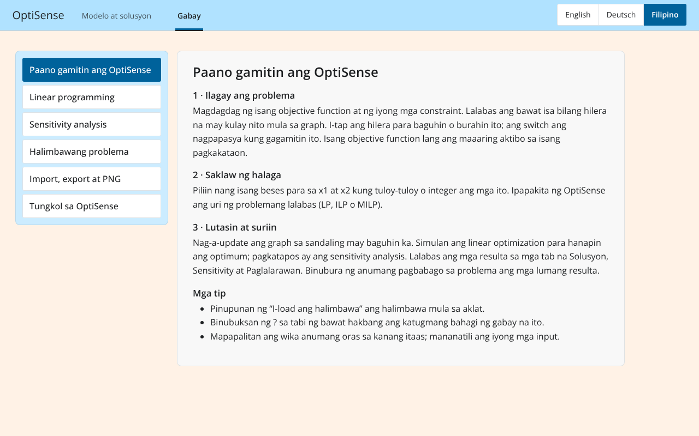

# OptiSense


## Table of Contents

1. [About the Project](#about-the-project)
2. [Technologies Used](#technologies-used)
3. [Installation](#installation)
4. [Usage](#usage)
5. [Application Structure](#application-structure)
6. [Contributing](#contributing)
7. [License](#license)
8. [Contact](#contact)

## About the Project

**OptiSense** is an educational tool designed to solve **linear programming (LP)**, **integer linear programming (ILP)**, and **mixed-integer linear programming (MILP)** problems, including **sensitivity analysis**. 

The application was developed as part of a bachelor's thesis titled:  
*"Shiny in Python: An interactive visualization, solution, and sensitivity analysis tool for simple LP and (M)ILP problems using `scipy.optimize.milp` and `lp_solve`."*

This tool is intended to help users understand linear programming concepts and sensitivity analysis fundamentals.

## Technologies Used

OptiSense is built using the following technologies:

- **Python** – Core programming language.
- **Shiny for Python** – Framework for interactive web applications.
- **Matplotlib & Pandas** – For visualization and data handling.
- **Scipy.optimize** – Used for optimization:
  - `scipy.optimize.LinearConstraint` – Defines linear constraints.
  - `scipy.optimize.milp` – Solves mixed-integer linear programming (MILP) problems.
  - `scipy.optimize.OptimizeResult` – Represents the results of optimization computations.
- **lp_solve** – External solver for additional optimization tasks.

## Installation

To install and run OptiSense locally, follow these steps:

1. **Clone the repository**:

    ```bash
    git clone https://github.com/IVIcSunShine/shiny-python-linear-programming-education-tool.git
    ```

2. **Navigate to the project directory**:

    ```bash
    cd shiny-python-linear-programming-education-tool
    ```

3. **Create a virtual environment**:

    ```bash
    python -m venv env
    ```

4. **Activate the virtual environment**:

    - On Windows:

        ```bash
        .\env\Scriptsctivate
        ```

    - On macOS/Linux:

        ```bash
        source env/bin/activate
        ```

5. **Install dependencies**:

    ```bash
    pip install -r requirements.txt
    ```

## Usage

After installing the dependencies, launch the application with:

```bash
cd shiny_files
shiny run --port 8000 app.py
```

Then open `http://localhost:8000` in your browser. With Docker: `docker compose up --build` (see `Dockerfile`, `Caddyfile`).

### Features

- **Workflow in three steps** – enter the problem, choose the value range, solve and analyse. Each step shows its status and what is still missing.
- **One list for all functions** – up to two objective functions and up to five constraints, added with “+ New” next to the headings. Each appears as a row with its graph colour; tap a row to edit or delete it, and use the switch to include or exclude it. Only one objective function is active at a time.
- **Value range once per variable** – x1 and x2 are set to continuous or integer once; OptiSense derives LP, ILP or MILP.
- **Exact graph** – the feasible region is computed geometrically (LP polygon, integer lattice points, MILP lines), constraints have fixed colours and are labelled directly in the graph.
- **Solve** with `scipy.optimize.milp`; infeasible and unbounded problems are explained instead of failing.
- **Sensitivity analysis** with `lp_solve`: shadow prices with their valid range of b, objective-coefficient ranges, and a sentence explaining each result.
- **Languages** – English, German and Filipino in a compact language menu (more can be added), switchable at any time without losing input.
- **Import & export** in the LP format (files from earlier versions still import) and **PNG export** of the graph.
- Built for student laptops and iPads from 12 inch (works from 1024 × 650 px, touch targets ≥ 44 px).

## Application Structure


**Model & solution**: the graphical solution is the central element; left, the three workflow steps (can be hidden with the ‹ button in the graph header); right, the results in the tabs *Solution*, *Sensitivity* and *Description*. All three columns stay side by side from 1024 px width.



**Guide**: how to use OptiSense, short introductions to linear programming and sensitivity analysis, the textbook example (loadable with one click) and import/export. The **?** next to each step opens the matching section in place.

### Code layout

```
shiny_files/
├── app.py                     entry point (shiny run app.py)
├── www/                       optisense.css (design system, fluid sizing), optisense.js (language, list, sidebar)
└── optisense/
    ├── config.py              limits (2 objective functions, 5 constraints), example names, graph colours
    ├── plotting.py            the matplotlib graph
    ├── core/                  maths, no Shiny code
    │   ├── model.py           problem type, integrality, slack / binding
    │   ├── solver.py          scipy.optimize.milp
    │   ├── geometry.py        axis bounds, feasible region, lines, dummy objective line
    │   ├── lp_format.py       .lp import / export
    │   └── sensitivity.py     lp_solve call and output parsing
    ├── i18n/                  all texts: texts.py (interface), guide_texts.py (guide), __init__.py (t, fmt_num)
    ├── ui/                    components.py (step card, translated text), layout.py (page)
    └── server/                context.py (shared state) and one module per area:
                               problem (step 1), value_range (step 2), solving (step 3),
                               graph, results, files (import/export, example, reset), guide
tests/test_core.py             unit tests: python -m unittest discover -s tests
```

### Adding or changing a language

All texts live in `shiny_files/optisense/i18n/` (`texts.py`, `guide_texts.py`). Add a language code to `LANGS` and a translation to every entry of `TEXT` and `GUIDE`; the unit tests check that no entry is missing and that placeholders such as `{name}` match. The Filipino texts are a first draft and should be reviewed by a native speaker.

## Contributing

Contributions are welcome! If you find a bug or have an idea for an improvement, feel free to open an **Issue** or a **Pull Request**. Please follow the contribution guidelines.

## License

Distributed under the **GPL-3.0** License. See `LICENSE` for more information.

## Contact

For inquiries or collaboration, please contact:

- **GitHub**: [IVIcSunShine](https://github.com/IVIcSunShine)
- **Email**: [Your Email Here]

---

We hope you enjoy using **OptiSense**! 🚀
