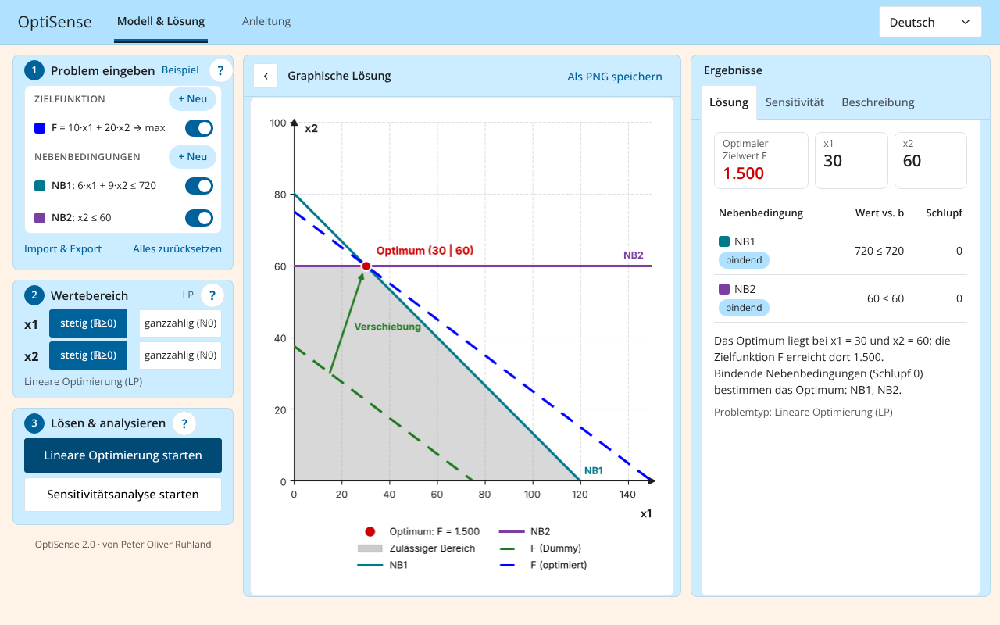
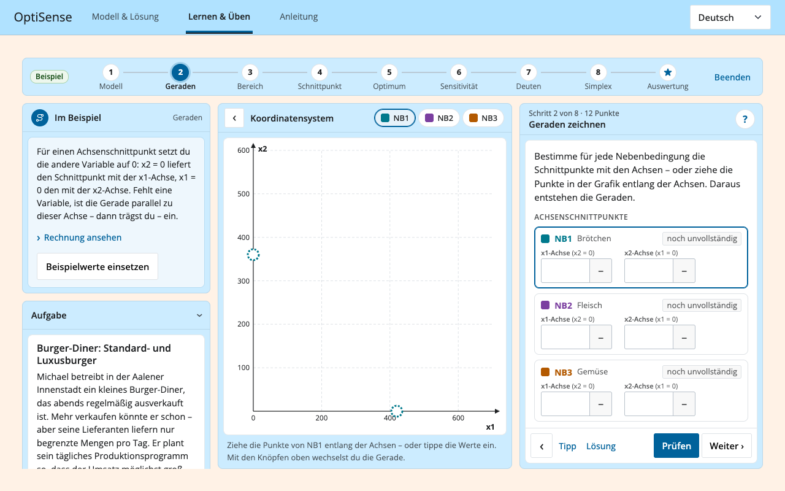
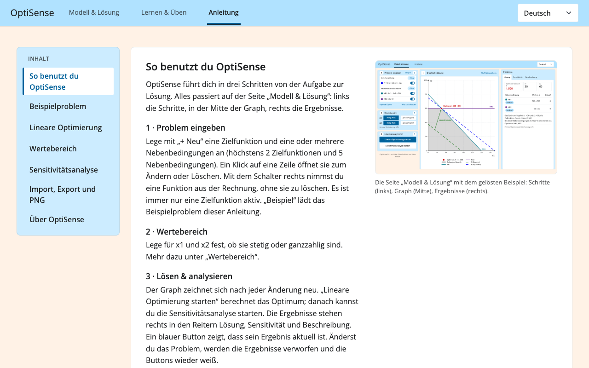

# OptiSense


## Table of Contents

1. [About the Project](#about-the-project)
2. [Technologies Used](#technologies-used)
3. [Installation](#installation)
4. [Usage](#usage)
5. [Application Structure](#application-structure)
6. [Contributing](#contributing)
7. [License](#license)
8. [Contact](#contact)

## About the Project

**OptiSense** is an educational tool designed to solve **linear programming (LP)**, **integer linear programming (ILP)**, and **mixed-integer linear programming (MILP)** problems, including **sensitivity analysis**. 

OptiSense 1.0 was developed by Peter Ruhland as part of his bachelor's thesis at Aalen University titled:  
*"Shiny in Python: An interactive visualization, solution, and sensitivity analysis tool for simple LP and (M)ILP problems using `scipy.optimize.milp` and `lp_solve`."*  
Version 2.0 was further developed and optimized by Peter Ruhland and Robin Heissler as part of their master's studies.

This tool is intended to help users understand linear programming concepts and sensitivity analysis fundamentals.

## Technologies Used

OptiSense is built using the following technologies:

- **Python** – Core programming language.
- **Shiny for Python** – Framework for interactive web applications.
- **Matplotlib & Pandas** – For visualization and data handling.
- **Scipy.optimize** – Used for optimization:
  - `scipy.optimize.LinearConstraint` – Defines linear constraints.
  - `scipy.optimize.milp` – Solves mixed-integer linear programming (MILP) problems.
  - `scipy.optimize.OptimizeResult` – Represents the results of optimization computations.
- **lp_solve** – External solver for additional optimization tasks.

## Installation

To install and run OptiSense locally, follow these steps:

1. **Clone the repository**:

    ```bash
    git clone https://github.com/IVIcSunShine/shiny-python-linear-programming-education-tool.git
    ```

2. **Navigate to the project directory**:

    ```bash
    cd shiny-python-linear-programming-education-tool
    ```

3. **Create a virtual environment**:

    ```bash
    python -m venv env
    ```

4. **Activate the virtual environment**:

    - On Windows:

        ```bash
        .\env\Scriptsctivate
        ```

    - On macOS/Linux:

        ```bash
        source env/bin/activate
        ```

5. **Install dependencies**:

    ```bash
    pip install -r requirements.txt
    ```

## Usage

After installing the dependencies, launch the application with:

```bash
cd shiny_files
shiny run --port 8000 app.py
```

Then open `http://localhost:8000` in your browser. With Docker: `docker compose up --build` (see `Dockerfile`, `Caddyfile`). Securing the server (updates, SSH, firewall, monthly image rebuild): `docs/server-security.md`; a read-only check: `sudo bash tools/server_check.sh`.

### Features

- **Workflow in three steps** – enter the problem, choose the variable types, solve and analyze. Each step shows its status and what is still missing.
- **One list for all functions** – up to two objective functions and up to five constraints, added with “+ New” next to the headings. Each appears as a row with its graph colour; tap a row to edit or delete it, and use the switch to include or exclude it. Only one objective function is active at a time.
- **Variable type once per variable** – x1 and x2 are set to continuous or integer once; OptiSense derives LP, ILP or MILP.
- **Exact graph** – the feasible region is computed geometrically (LP polygon, integer lattice points, MILP lines), constraints have fixed colours and are labelled directly in the graph.
- **Solve** with `scipy.optimize.milp`; infeasible and unbounded problems are explained instead of failing.
- **Sensitivity analysis** with `lp_solve`: shadow prices with their valid range of b, objective-coefficient ranges, and a sentence explaining each result.
- **Languages** – English and German in a compact language menu, switchable at any time without losing input.
- **Learn & practice** – solve problems yourself, step by step: a guided example (the burger problem from the lecture, every step worked out), generated practice tasks (word problems or formulas, two levels with 2 or 3 constraints, continuous, integer or mixed variables, six topics) and your own problem from “Model & solution”. Every task first shows only the task; word problems are then modelled in two steps (objective and variable types, then the constraints). Lines are drawn via their axis intersections, MILP regions are drawn as grey bars – as on the lecture slides. For an LP you first move the objective line and tap the optimal corner (it snaps to the corners), then calculate this corner exactly; integer tasks snap to whole numbers. The graph never shows the objective value – the learner calculates it. Word problems name the objective (revenue, costs …) and the constraints (C1 Buns …) in front of the formulas. Each step can be checked, with hints; “Solution” fills the correct values into the fields, with the worked solution one click away – once the steps before are filled in; an exam mode grades only after handing in. Up to 100 points and an evaluation that can be saved as a PDF file (made on the server with matplotlib, `pages/learn/report.py`) – with the task, the model, the graphical solution (feasible region, objective line, optimal point) and every step: the learner's answers next to the correct ones, with the worked solution.
- **Import & export** in the LP format (files from earlier versions still import) and **PNG export** of the graph.
- Built for student laptops, iPads and smartphones from 6.1 inch (touch targets ≥ 44 px). From 1024 px width the columns stand side by side; on smartphones (portrait below 576 px, landscape up to 500 px height) every page shows its blocks in one column – steps, graph, results – and the graph of “Learn & practice” works by touch (a swipe scrolls, the handles can be dragged, a tap sets the optimum).

## Application Structure



**Model & solution**: the graphical solution is the central element; left, the three workflow steps (can be hidden with the ‹ button in the graph header); right, the results in the tabs *Solution*, *Sensitivity* and *Description*. All three columns stay side by side from 1024 px width.



**Learn & practice**: the same three-column layout as “Model & solution” – the task text on the left, an interactive coordinate system in the middle (drag the points of a line, the objective line by its handle, or your optimum), the current step on the right. A stepper on top shows where you are and which steps are correct. Steps: understand the task, objective & value range and constraints (word problems only), draw the lines, feasible region, optimal corner (LP only), optimum, slack (how much is left over and which constraints are binding, as in the lecture – shadow prices stay on “Model & solution”), interpret the result. The graph appears with the lines (while the model is set up it would stay empty), and the **?** of each step opens “How to do it” right below the step title.



**Guide**: how to use OptiSense, short introductions to linear programming and sensitivity analysis, the textbook example (loadable with one click) and import/export. The **?** next to each step opens the matching section in place.

### Code layout

Each of the three pages has its own package with its texts, layout and server part, and its own stylesheet and script in `www/`. Shared parts (maths, translation, the frame with navbar and language menu, the per-session state) live outside `pages/`.

```
shiny_files/
├── app.py                     entry point (shiny run app.py)
├── www/
│   ├── optisense.css / .js    shared: design tokens, navbar, components, language switch
│   ├── work.css / .js         start page “Model & solution”
│   ├── learn.css / .js        “Learn & practice” (the page is drawn in the browser)
│   ├── guide.css / .js        “Guide”
│   └── guide/en, guide/de     pictures of the guide
└── optisense/
    ├── pages/
    │   ├── work/              start page “Model & solution”
    │   │   ├── texts.py       its texts (English, German)
    │   │   ├── ui.py          workflow sidebar with the three steps, graph card, results tabs
    │   │   ├── plotting.py    the matplotlib graph
    │   │   └── server/        problem (step 1), value_range (step 2), solving (step 3), graph, results,
    │   │                      files (import/export, example, reset), help_dialog (the ? buttons), html_utils
    │   ├── learn/             “Learn & practice”
    │   │   ├── texts.py       its texts (keys start with learn_)
    │   │   ├── ui.py          the panel that www/learn.js fills
    │   │   ├── server.py      requests from www/learn.js; the expected answers stay on the server
    │   │   └── engine.py, story.py, solution.py, tutorial.py, report.py (the evaluation as a PDF)
    │   │                      exercises without Shiny code: generation, grading, task texts,
    │   │                      worked solutions, guided example, scipy.optimize.milp code
    │   └── guide/             “Guide”
    │       ├── texts.py       short texts (contents, figure captions)
    │       ├── content.py     the sections in English and German, also shown by the ? buttons
    │       ├── ui.py          contents list and text column
    │       └── server.py      renders the sections in the chosen language
    ├── core/                  maths of the start page, no Shiny code: model, solver (scipy.optimize.milp),
    │                          geometry, lp_format (.lp import/export), sensitivity (lp_solve)
    ├── i18n/                  t(), fmt_num(), the language list; common.py holds texts used on several pages
    ├── ui/                    layout.py (navbar with the three pages, styles, scripts), components.py (translated text)
    ├── server/                server(): one AppContext per session (context.py) shared by the pages
    └── config.py              limits (2 objective functions, 5 constraints), default names, colours
tests/test_core.py             maths, import/export and texts: python -m unittest discover -s tests
tests/test_learning.py         exercises, grading and the texts of the learning page
tests/test_structure.py        the pages stay separate (no imports between them except the ? dialogs, unique text keys)
tools/                         guide_images.py and guide_screenshots.py create the pictures of the guide
```

### Texts and languages

OptiSense is available in English and German. Each page keeps its texts next to its code (`pages/*/texts.py`, the guide sections in `pages/guide/content.py`); texts used on several pages are in `i18n/common.py`. Every entry has an `en` and a `de` version; the unit tests check that none is missing and that placeholders such as `{name}` match. A further language needs a code in `LANGS` (`i18n/__init__.py`) and a translation in every entry.

## Contributing

Contributions are welcome! If you find a bug or have an idea for an improvement, feel free to open an **Issue** or a **Pull Request**. Please follow the contribution guidelines.

## License

Distributed under the **GPL-3.0** License. See `LICENSE` for more information.

## Contact

For inquiries or collaboration, please contact:

- **GitHub**: [IVIcSunShine](https://github.com/IVIcSunShine)
- **Email**: [Your Email Here]

---

We hope you enjoy using **OptiSense**! 🚀
